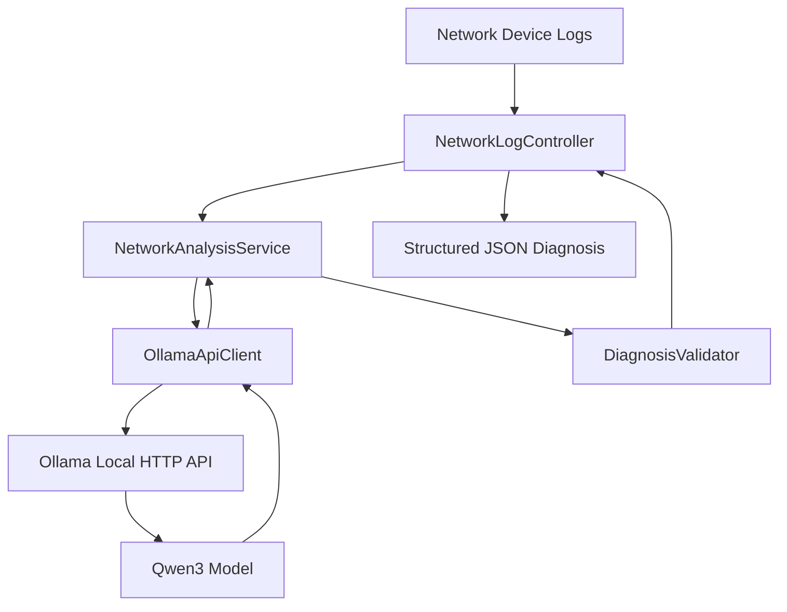

# AI-Powered Network Troubleshooting Agent

A Java 17 / Spring Boot REST API that analyzes network device logs using a **locally hosted AI model** and returns structured troubleshooting recommendations. The application uses **Ollama and Qwen3**, so it does not require a paid cloud AI API key.

> **Status:** Phases 1–3 complete (REST API, local AI integration, automated tests). GitHub documentation is being finalized in Phase 4; MCP tool integration is planned for Phase 5.

## Features

- Accepts logs from routers, switches, and wireless access points through a REST API.
- Generates a problem summary, possible root causes, severity, and recommended troubleshooting steps.
- Uses a local Ollama model instead of a paid cloud API.
- Validates incoming requests and checks the structure of AI responses.
- Provides consistent HTTP error responses for invalid requests and AI-service failures.
- Includes unit and controller tests with JUnit 5, Mockito, and MockMvc.
- Tests Ollama client responses with a local fake HTTP server, without loading the model.
- Produces JaCoCo code-coverage reports.

**Important:** AI diagnoses are hypotheses, not confirmed root causes. Use synthetic or appropriately sanitized logs; the current project is intended for local development and demonstration, not an authenticated production deployment.

## Tech stack

| Component | Technology |
| --- | --- |
| Language | Java 17 |
| Backend framework | Spring Boot 3.5.16 |
| Build tool | Maven + Maven Wrapper |
| REST layer | Spring Web / Spring MVC |
| Local AI runtime | Ollama |
| AI model | `qwen3:4b-instruct` |
| JSON | Jackson |
| Validation | Jakarta Bean Validation |
| Tests | JUnit 5, Mockito, MockMvc |
| Coverage | JaCoCo |
| Version control | Git / GitHub |

## Architecture



**Key packages** (relative to `src/main/java/com/networkagent/`):

- `controller/` — REST endpoints and HTTP responses.
- `service/` — Analysis orchestration and response validation.
- `client/` — HTTP integration with local Ollama.
- `dto/` — Request and diagnosis records.
- `exception/` — Controlled error responses.

## Prerequisites

- JDK 17
- macOS, Windows, or Linux with sufficient resources for a local model
- [Ollama](https://ollama.com/download)
- Git (optional, for cloning)

The repository includes the Maven Wrapper, so a separate Maven installation is not required.

## Getting started (macOS/Linux)

### 1. Clone the repository

```bash
git clone https://github.com/YOUR_USERNAME/ai-network-troubleshooting-agent.git
cd ai-network-troubleshooting-agent
```

Replace `YOUR_USERNAME` with the actual owner after publishing. If you already have the project locally, work in that directory instead of cloning.

### 2. Install and start Ollama

Install Ollama from its official download page, then ensure the app/server is running. If you are running the server manually and none is active:

```bash
ollama serve
```

Use a different terminal for the remaining commands. Download the model:

```bash
ollama pull qwen3:4b-instruct
ollama list
```

### 3. Review application configuration

The following values are configured in `src/main/resources/application.properties`:

```properties
server.port=8080
ollama.api.url=http://localhost:11434
ollama.api.model=qwen3:4b-instruct
```

Ollama running locally does not need an API key. Do not commit passwords, API tokens, `.env` files, or private network logs.

### 4. Build and run Spring Boot

```bash
./mvnw clean verify
./mvnw spring-boot:run
```

The REST API runs at `http://localhost:8080` unless you change the port.

**Windows PowerShell equivalents:**

```powershell
.\mvnw.cmd clean verify
.\mvnw.cmd spring-boot:run
```

## REST API reference

### Health check

`GET /api/v1/health`

```bash
curl http://localhost:8080/api/v1/health
```

Expected response:

```json
{"status":"UP"}
```

### Analyze network logs

`POST /api/v1/logs/analyze`

Content type: `application/json`

```bash
curl -i -X POST http://localhost:8080/api/v1/logs/analyze \
  -H "Content-Type: application/json" \
  -d '{
    "deviceName": "Office-AP-01",
    "deviceType": "ACCESS_POINT",
    "logContent": "Client disconnected due to authentication timeout. RADIUS server did not respond."
  }'
```

Example response (the locally generated diagnosis will vary):

```json
{
  "problemSummary": "Wireless authentication timed out because the access point did not receive a RADIUS response.",
  "possibleRootCauses": [
    "RADIUS server unavailable or unreachable",
    "Network path or firewall blocking RADIUS traffic",
    "RADIUS server configuration mismatch"
  ],
  "severity": "MEDIUM",
  "recommendedSteps": [
    "Verify that the RADIUS server is running and reachable",
    "Review authentication server logs",
    "Check the configured server address, port, and shared secret",
    "Inspect relevant firewall rules"
  ]
}
```

The API returns HTTP **200** for a successful diagnosis.

### Request fields

| Field | Type | Rules |
| --- | --- | --- |
| `deviceName` | String | Required; not blank; maximum 100 characters |
| `deviceType` | String | Required; not blank; maximum 50 characters |
| `logContent` | String | Required; not blank; maximum 20,000 characters |

### Error responses

- **400 Bad Request** — Invalid request (`VALIDATION_ERROR`) with validation details.
- **502 Bad Gateway** — Local AI analysis failed (`AI_SERVICE_ERROR`).

Example invalid request:

```bash
curl -i -X POST http://localhost:8080/api/v1/logs/analyze \
  -H "Content-Type: application/json" \
  -d '{"deviceName":"","deviceType":"ROUTER","logContent":""}'
```

## Testing and coverage

Run all tests and generate the JaCoCo report:

```bash
./mvnw clean verify
```

Run the service test alone:

```bash
./mvnw test -Dtest=NetworkAnalysisServiceTest
```

Open the HTML coverage report on macOS:

```bash
open target/site/jacoco/index.html
```

**Recorded Phase 3 coverage:** 94% instruction coverage and 69% branch coverage (JaCoCo 0.8.15). These are snapshot results and may change with subsequent commits. The test suite covers controller, service, response validation, and fake-server Ollama client behavior.

## Security and limitations

- The Ollama model runs locally, with no paid Anthropic API dependency.
- Treat log content as untrusted input; model instructions cannot reliably substitute for input sanitization.
- Do not send private production logs to this demonstration service without review and redaction.
- There is no authentication or authorization layer for public deployment yet.
- The service does not independently confirm that an AI diagnosis is correct.
- MCP tools, production-grade redaction, rate limiting, and deployment controls are future work.

## Troubleshooting

**Connection refused on port 8080:** Start Spring Boot, or check whether another process occupies the port.

**HTTP 502 from `/logs/analyze`:** Ensure Ollama is running at `http://localhost:11434` and the configured model is installed (`ollama list`). Look at sanitized server logs for the error category.

**Model not found:** Run `ollama pull qwen3:4b-instruct`, and ensure `ollama.api.model` matches the installed model name.

**Maven compile failure:** Check `java -version` (should be Java 17), confirm the Spring Boot parent version in `pom.xml`, and run `./mvnw clean verify`.

## Roadmap

- [x] Phase 1 — Spring Boot REST API and request validation
- [x] Phase 2 — Local Ollama model and structured AI diagnosis
- [x] Phase 3 — Unit tests, HTTP tests, response validation, and JaCoCo
- [ ] Phase 4 — Publish documented GitHub repository
- [ ] Phase 5 — Safely approved, read-only MCP troubleshooting tools

## License

No license has been selected yet. Add a `LICENSE` file if you decide to open-source the project under a specific license.
