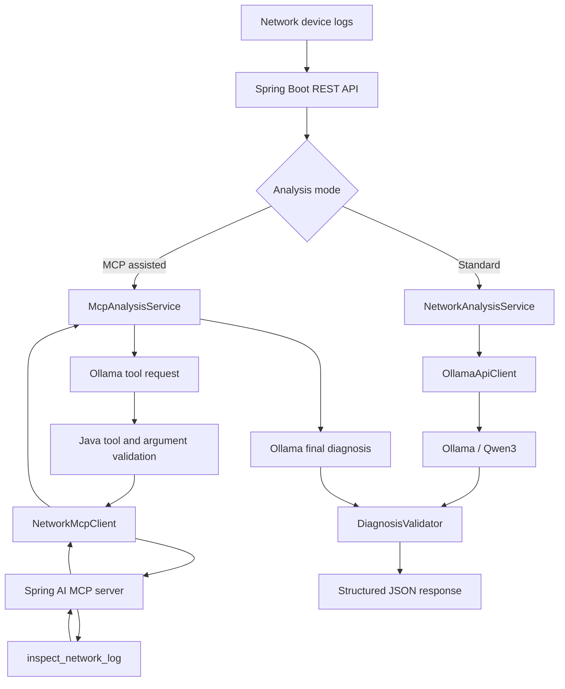

# AI-Powered Network Troubleshooting Agent

**A Java Spring Boot backend application that uses locally hosted AI and the Model Context Protocol (MCP) to analyze network device logs, identify potential root causes, and recommend troubleshooting actions.**

Built with **Java 17, Spring Boot 3.5.16, Maven, Ollama, Qwen3, Spring AI MCP, JUnit 5, Mockito, and JaCoCo**.

**Repository:** https://github.com/ahmadmuh062/ai-network-troubleshooting-agent

## Overview

The AI-Powered Network Troubleshooting Agent helps network administrators and engineers investigate problems reported in logs from routers, switches, wireless access points, and related network services.

It exposes REST endpoints for two modes of diagnosis:

- **Standard AI analysis:** submit device logs to a locally running Ollama model and receive a structured diagnosis.
- **MCP-assisted analysis:** allow the model to request an approved, read-only diagnostic tool via the Model Context Protocol before generating its final diagnosis.

Both modes return a **problem summary, possible root causes, severity, and recommended troubleshooting steps**. The project runs locally **without a paid AI API key**.

> **Scope:** Diagnoses are hypotheses derived from log text, not verified network measurements. This project is a local portfolio demonstration, not a production monitoring or incident-response platform.

## Features

- Java 17 and Spring Boot REST APIs with request validation.
- Local AI inference using **Ollama** and **`qwen3:4b-instruct`**.
- Structured JSON diagnoses with severity values `LOW`, `MEDIUM`, `HIGH`, or `CRITICAL`.
- MCP server exposing the approved `inspect_network_log` diagnostic tool.
- MCP client integration and a controlled Ollama tool-calling workflow.
- Tool allowlisting, original-log argument checks, and a maximum of one approved MCP execution per analysis.
- Deterministic detection of common network-log indicators.
- Controlled error responses and diagnosis validation.
- JUnit 5, Mockito, Spring MockMvc, local HTTP test doubles, and JaCoCo coverage reporting.

## Technology Stack

| Area | Technology |
| --- | --- |
| Language | Java 17 |
| Backend | Spring Boot 3.5.16 / Spring MVC |
| Build | Maven and Maven Wrapper |
| AI runtime | Ollama |
| Model | Qwen3 4B Instruct (`qwen3:4b-instruct`) |
| HTTP client | Spring `RestClient` |
| JSON | Jackson / JSON Schema |
| Agent protocol | Model Context Protocol (MCP) |
| MCP framework | Spring AI MCP |
| Validation | Jakarta Bean Validation |
| Testing | JUnit 5, Mockito, MockMvc |
| Coverage | JaCoCo |
| Source control | Git and GitHub |

## Architecture



**Main components**

| Component | Responsibility |
| --- | --- |
| `NetworkLogController` | Health check and standard AI REST endpoint |
| `McpAnalysisController` | MCP-assisted REST endpoint |
| `NetworkAnalysisService` | Standard analysis orchestration |
| `McpAnalysisService` | Ollama tool requests, MCP invocation, final diagnosis |
| `OllamaApiClient` | Local Ollama chat API integration |
| `NetworkMcpClient` | MCP protocol client for approved tools |
| `NetworkDiagnosticTools` | Read-only detection of known failure indicators |
| `McpToolConfig` | Registration of tool callbacks with the MCP server |
| `DiagnosisValidator` | Validates model-generated diagnoses |
| `GlobalExceptionHandler` | Converts validation and AI errors into API responses |

## MCP Diagnostic Tool

The server exposes **`inspect_network_log`**, a deterministic, read-only tool for scanning submitted log text.

| Indicator | Meaning |
| --- | --- |
| `RADIUS_TIMEOUT` | RADIUS authentication response timeout indicator |
| `DHCP_POOL_EXHAUSTED` | Possible DHCP address-pool exhaustion |
| `LINK_DOWN` | Interface down-state indicator |
| `PACKET_LOSS` | Packet-loss indicator |
| `NO_KNOWN_PATTERNS` | None of the recognized patterns were found |

Example input:

```text
RADIUS server did not respond. Authentication timeout.
```

Example tool finding:

```text
RADIUS_TIMEOUT: Authentication server response timeout detected
```

The tool does **not** run shell commands, inspect arbitrary files, make network connections to devices, or change device configurations. A pattern match is evidence of text in a log, **not proof of a root cause**.

### MCP-Assisted Workflow

1. Spring Boot receives and validates a log-analysis request.
2. Ollama/Qwen3 receives the log and the definition of the one approved tool.
3. Qwen3 requests `inspect_network_log`.
4. Java rejects unapproved names, extra arguments, altered logs, or multiple requests.
5. `NetworkMcpClient` calls the local MCP server using MCP.
6. The MCP tool returns detected indicators.
7. The tool result is returned to Ollama, which produces a final structured diagnosis.
8. Java validates the diagnosis and returns it to the REST caller.

At most **one** approved tool execution is permitted per request.

## API Reference

Base URL: `http://127.0.0.1:8080`

### Health Check

**`GET /api/v1/health`**

```bash
curl http://127.0.0.1:8080/api/v1/health
```

Expected response (`200 OK`):

```json
{"status":"UP"}
```

### Standard AI Analysis

**`POST /api/v1/logs/analyze`**

```bash
curl -i -X POST http://127.0.0.1:8080/api/v1/logs/analyze \
  -H "Content-Type: application/json" \
  -d '{
    "deviceName": "Office-AP-01",
    "deviceType": "ACCESS_POINT",
    "logContent": "Client disconnected due to authentication timeout. RADIUS server did not respond."
  }'
```

### MCP-Assisted AI Analysis

**`POST /api/v1/logs/analyze-with-tools`**

```bash
curl -i -X POST http://127.0.0.1:8080/api/v1/logs/analyze-with-tools \
  -H "Content-Type: application/json" \
  -d '{
    "deviceName": "Office-AP-01",
    "deviceType": "ACCESS_POINT",
    "logContent": "RADIUS server did not respond. Authentication timeout."
  }'
```

**Illustrative successful response** (`200 OK`; model wording may vary):

```json
{
  "problemSummary": "Authentication timed out because the RADIUS server did not respond.",
  "possibleRootCauses": [
    "The RADIUS server may be unreachable or unavailable",
    "RADIUS requests may be blocked by a firewall"
  ],
  "severity": "MEDIUM",
  "recommendedSteps": [
    "Verify RADIUS server availability and reachability",
    "Inspect RADIUS server logs",
    "Review authentication server and firewall configuration"
  ]
}
```

When the MCP-assisted workflow succeeds, the Spring Boot console logs include messages similar to:

```text
Executing approved MCP tool
MCP-assisted diagnosis completed, severity=MEDIUM
```

### MCP Protocol Endpoint

**`/mcp`** — Streamable HTTP / stateless MCP endpoint for protocol-compatible clients; not a regular webpage. The local endpoint is `http://127.0.0.1:8080/mcp`.

### Validation and Error Responses

Invalid request (`400 Bad Request`):

```json
{
  "status": 400,
  "error": "VALIDATION_ERROR",
  "message": "Invalid network log request",
  "details": [
    "deviceName: Device name is required",
    "logContent: Log content is required"
  ]
}
```

AI/MCP failure (`502 Bad Gateway`):

```json
{
  "status": 502,
  "error": "AI_SERVICE_ERROR",
  "message": "Network log analysis is temporarily unavailable"
}
```

## Project Structure

```text
ai-network-troubleshooting-agent/
├── pom.xml
├── README.md
├── .gitignore
├── mvnw
├── mvnw.cmd
├── .mvn/
└── src/
    ├── main/
    │   ├── java/com/networkagent/
    │   │   ├── NetworkAgentApplication.java
    │   │   ├── client/OllamaApiClient.java
    │   │   ├── controller/
    │   │   │   ├── NetworkLogController.java
    │   │   │   └── McpAnalysisController.java
    │   │   ├── dto/
    │   │   │   ├── NetworkLogRequest.java
    │   │   │   ├── NetworkLogResponse.java
    │   │   │   └── DiagnosisResponse.java
    │   │   ├── service/
    │   │   │   ├── NetworkAnalysisService.java
    │   │   │   ├── McpAnalysisService.java
    │   │   │   └── DiagnosisValidator.java
    │   │   ├── mcp/
    │   │   │   ├── NetworkDiagnosticTools.java
    │   │   │   ├── NetworkMcpClient.java
    │   │   │   └── McpToolConfig.java
    │   │   └── exception/
    │   │       ├── AiServiceException.java
    │   │       └── GlobalExceptionHandler.java
    │   └── resources/application.properties
    └── test/java/com/networkagent/
        ├── client/OllamaApiClientTest.java
        ├── controller/
        │   ├── NetworkLogControllerTest.java
        │   └── McpAnalysisControllerTest.java
        ├── service/
        │   ├── NetworkAnalysisServiceTest.java
        │   ├── McpAnalysisServiceTest.java
        │   └── DiagnosisValidatorTest.java
        └── mcp/
            ├── NetworkDiagnosticToolsTest.java
            └── NetworkMcpClientIntegrationTest.java
```

`target/` is generated by Maven and should remain untracked.

## Prerequisites

- **Java 17** — check with `java -version`.
- **Maven Wrapper** — included (`./mvnw` on macOS/Linux, `.\mvnw.cmd` on Windows).
- **Ollama** — install from https://ollama.com/download.
- **Qwen3 model** — download with `ollama pull qwen3:4b-instruct`.

The first model download needs internet access and local disk space. Inference then runs locally without per-request AI API fees.

## Getting Started (macOS / Linux)

### 1. Clone

```bash
git clone https://github.com/ahmadmuh062/ai-network-troubleshooting-agent.git
cd ai-network-troubleshooting-agent
```

### 2. Start Ollama

Open the Ollama app, or run `ollama serve` if it is not already running. Confirm the installed model:

```bash
ollama pull qwen3:4b-instruct
ollama list
curl http://localhost:11434/api/tags
```

### 3. Configure the Application

These are the relevant local `src/main/resources/application.properties` settings:

```properties
spring.application.name=ai-network-troubleshooting-agent
server.port=8080
server.address=127.0.0.1

ollama.api.url=http://localhost:11434
ollama.api.model=qwen3:4b-instruct

logging.level.root=INFO
logging.level.com.networkagent=INFO
server.error.include-message=never
server.error.include-stacktrace=never
server.error.include-binding-errors=never

spring.ai.mcp.server.enabled=true
spring.ai.mcp.server.name=network-troubleshooting-mcp
spring.ai.mcp.server.version=1.0.0
spring.ai.mcp.server.type=SYNC
spring.ai.mcp.server.protocol=STATELESS
spring.ai.mcp.server.stateless.mcp-endpoint=/mcp

spring.ai.mcp.client.enabled=false
network.mcp.url=http://127.0.0.1:8080
network.mcp.endpoint=/mcp
```

The REST API and MCP server run in the same Spring Boot application. The MCP client uses the localhost MCP endpoint. No Anthropic key or cloud API account is required.

### 4. Build and Test

```bash
./mvnw clean verify
```

Look for `BUILD SUCCESS`.

### 5. Run Spring Boot

```bash
./mvnw spring-boot:run
```

In another terminal, verify `GET /api/v1/health` and try one of the POST examples above.

## Windows PowerShell

```powershell
.\mvnw.cmd clean verify
.\mvnw.cmd spring-boot:run
```

To send an MCP-assisted request:

```powershell
$body = @{
    deviceName = "Office-AP-01"
    deviceType = "ACCESS_POINT"
    logContent = "RADIUS server did not respond. Authentication timeout."
} | ConvertTo-Json

Invoke-RestMethod `
    -Uri "http://127.0.0.1:8080/api/v1/logs/analyze-with-tools" `
    -Method POST `
    -ContentType "application/json" `
    -Body $body
```

## Testing

The test suite uses JUnit 5, Mockito, MockMvc, and local simulated HTTP responses to exercise controller, service, AI client, validation, MCP tool, and agent logic.

Run everything:

```bash
./mvnw clean verify
```

Run the eight MCP agent security tests:

```bash
./mvnw test -Dtest=McpAnalysisServiceTest
```

The dedicated agent tests cover:

1. Successful approved tool execution.
2. Rejection of unauthorized tool requests.
3. Rejection of modified log arguments.
4. Rejection of multiple tool calls.
5. Handling MCP execution failures.
6. Rejection of incomplete Ollama responses.
7. Rejection of further tool calls after the approved one.
8. Rejection of invalid final diagnoses.

**Optional MCP integration test:** run the Spring Boot MCP server separately, then:

```bash
RUN_MCP_INTEGRATION=true ./mvnw test -Dtest=NetworkMcpClientIntegrationTest
```

This integration test uses the live local MCP server; ordinary isolated tests use mocks or local test doubles.

### Coverage

JaCoCo reports are generated by:

```bash
./mvnw clean verify
```

Open on macOS:

```bash
open target/site/jacoco/index.html
```

**Recorded Phase 3 baseline:** 94% instruction coverage and 69% branch coverage. These figures predate the additional Phase 5 classes and tests; consult the generated report for current results.

## Security and Limitations

Current local safeguards include:

- Only `inspect_network_log` is permitted for model-directed MCP execution.
- Tool arguments must exactly match the submitted log and contain no additional fields.
- No more than one approved tool is executed per request.
- The diagnostic tool uses local text inspection only.
- The service checks generated diagnosis fields and severity values.
- Requests use input-validation and log-length limits.
- API errors are mapped to controlled error responses.
- Spring Boot binds to `127.0.0.1` for local development.

**Not production-ready:** The application does not yet implement full authentication, authorization, sensitive-log redaction, rate limiting, concurrency controls, or hardened resource isolation. LLM-generated text and tool results are untrusted data, and tool authorization does not guarantee AI output accuracy. Use synthetic or sanitized logs.

## Troubleshooting

**HTTP 404 on `/api/v1/logs/analyze-with-tools`** — Confirm `McpAnalysisController.java` exists, the app was recompiled, and the running server was restarted.

**HTTP 502 from an analysis endpoint** — Check whether Ollama is running, the model is installed, the model requested the approved tool correctly, and the local MCP server is reachable. Inspect application logs without sharing credentials or private device data.

**Port 8080 already in use** — On macOS, run:

```bash
lsof -nP -iTCP:8080 -sTCP:LISTEN
```

Stop the older server process before restarting.

**MCP initialization failure** — Keep Spring Boot running while testing the MCP client. Confirm the `/mcp` endpoint and matching stateless Streamable HTTP transport.

**`Missing handler for notification type: notifications/initialized`** — This warning has occurred during otherwise successful stateless MCP communication in local testing. Verify actual tool invocation and integration tests rather than treating the warning alone as a failure.

**`No sampling methods found` / `No elicitation methods found`** — These optional MCP capabilities are not used by the present workflow.

**Test failures** — Inspect `target/surefire-reports/` and rerun the failing test class with Maven.

## Development Phases

| Phase | Delivered |
| --- | --- |
| 1. REST API foundation | Spring Boot project, DTOs, validation, health and analysis endpoints |
| 2. Free local AI | Ollama/Qwen3 integration and structured diagnoses |
| 3. Reliability | JUnit/Mockito/MockMvc tests, validators, error handling, JaCoCo |
| 4. Publishing | Setup and API documentation, GitHub repository |
| 5. MCP integration | MCP server/client, approved tool calling, end-to-end diagnosis, security tests |

## Future Improvements

- Authentication, authorization, and API rate limits.
- Sensitive-data redaction and audited diagnostic events.
- More approved read-only tools (e.g., allowlisted DNS and connectivity checks).
- Stronger timeout, concurrency, and resource controls.
- OpenAPI/Swagger documentation and GitHub Actions CI.
- Docker packaging and deployment documentation.
- Additional supported local models and diagnosis evaluation datasets.
- Persistent analysis history and a frontend dashboard.

## Engineering Skills Demonstrated

Java backend development, Spring Boot REST API design, dependency injection, local LLM integration, structured JSON outputs, MCP tool orchestration, tool authorization, error handling, automated testing, HTTP integration tests, Maven, JaCoCo, Git, and GitHub.

## License

No open-source license has been selected for this repository. This project is published as a portfolio and educational demonstration; reuse rights are not granted by an explicit license unless one is added.

## Author

GitHub: [@ahmadmuh062](https://github.com/ahmadmuh062)  
Repository: [AI-Powered Network Troubleshooting Agent](https://github.com/ahmadmuh062/ai-network-troubleshooting-agent)

---

*AI-generated troubleshooting recommendations are informational. Verify conclusions before making changes to production networks.*
